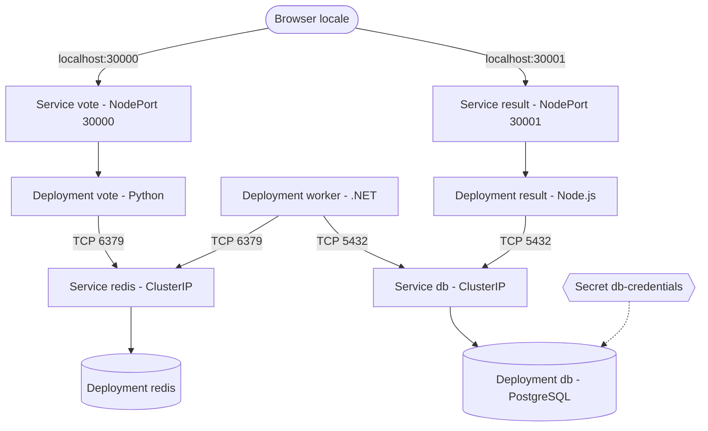

# Kiratech L2 Challenge - Voting App su Kubernetes locale (kind + Kustomize)

Ambiente locale riproducibile e laboratorio di troubleshooting L2 per la **Docker Example Voting App**, eseguita su un cluster **kind** e configurata con **Kustomize** (infrastructure as code dichiarativa, applicata con `kubectl apply -k`).

- Applicazione originale: [dockersamples/example-voting-app](https://github.com/dockersamples/example-voting-app). I manifest in `k8s/base` derivano dalle specifiche Kubernetes di quel progetto; per la licenza fare riferimento al repository originale.
- Le immagini usate sono quelle upstream (`dockersamples/examplevotingapp_*`, `postgres:15-alpine`, `redis:alpine`). **Non è stata fatta nessuna build di immagini.**

## Documentazione

| Documento | Contenuto |
|---|---|
| [docs/RUNBOOK.md](docs/RUNBOOK.md) | Controlli iniziali, comandi diagnostici, due scenari di errore, rollback, escalation |
| [docs/KRATEO.md](docs/KRATEO.md) | Valutazione concettuale di Krateo (template riutilizzabile) |
| [docs/AI_USAGE.md](docs/AI_USAGE.md) | Uso dell'AI: casi d'uso, verifiche manuali, limiti |

## Tracciabilità dei deliverable

| Richiesto dalla challenge | Dove si trova |
|---|---|
| Repository con configurazioni, manifest, script | `k8s/`, `Makefile`, `scripts/`, `kind-config.yaml` |
| README (app, prerequisiti, architettura, installazione, verifica, demo, rimozione) | Questo file |
| Manifest Kubernetes / Kustomize | `k8s/base`, `k8s/overlays/*` |
| Runbook L2 | [docs/RUNBOOK.md](docs/RUNBOOK.md) |
| Schema architetturale | Sezione [Architettura](#architettura) |
| Valutazione Krateo | [docs/KRATEO.md](docs/KRATEO.md) |
| Uso dell'AI | [docs/AI_USAGE.md](docs/AI_USAGE.md) |
| Plus: CI | `.github/workflows/ci.yml` |

## Scelta dell'applicazione

Online Boutique (suggerita dalla challenge) è composta da molti microservizi ed è onerosa in termini di CPU e RAM per un cluster locale. Ho scelto la **Voting App** perché:

- ha componenti eterogenei (Python, Node.js, .NET, Redis, PostgreSQL) e un flusso asincrono, quindi permette di mostrare dipendenze tra servizi;
- ha un footprint ridotto, adatto a un cluster kind su un portatile;
- ha già manifest Kubernetes semplici da leggere e adattare.

**Perimetro della demo:** tutti e 5 i componenti dell'app (vote, result, worker, redis, db). Nulla è stato escluso.

## Architettura



Flusso: l'utente vota su `vote`, il voto va in una coda Redis, il `worker` lo legge e lo scrive in PostgreSQL, `result` legge dal database e mostra i risultati.

| Componente | Risorsa | Service | Accesso |
|---|---|---|---|
| vote | Deployment (1 replica) | NodePort 80 -> 30000 | `http://localhost:30000` |
| result | Deployment (1 replica) | NodePort 80 -> 30001 | `http://localhost:30001` |
| worker | Deployment (1 replica) | nessuno | solo interno |
| redis | Deployment, `emptyDir` | ClusterIP 6379 | solo interno |
| db | Deployment, `emptyDir`, Secret | ClusterIP 5432 | solo interno |

Tutto gira nel namespace `voting-app`. Le porte 30000 e 30001 dell'host sono mappate sul nodo kind in `kind-config.yaml`.

## Struttura del repository

```text
k8s/base/                     manifest originali (Deployment e Service)
k8s/overlays/local/           namespace, Secret generato, porte, risorse, probe
k8s/overlays/custom-options/  demo di riconfigurazione (ConfigMap con le opzioni di voto)
k8s/overlays/incident-image/  incidente 1: immagine inesistente
k8s/overlays/incident-service/ incidente 2: selector del Service errato
scripts/e2e-test.sh           invia un voto e verifica che arrivi nel database
docs/                         runbook, Krateo, uso dell'AI
Makefile                      automazione (vedere `make help`)
```

## Prerequisiti

Docker (con daemon avviato), kind, kubectl, make.

Versioni con cui è stato provato: Sistema Operativo: `Debian 12 (Linux)`, Docker: `27.3.1`, kind: `v0.25.0`, kubectl: `v1.31.2` (nodo kind `v1.30.0`, fissato in `kind-config.yaml`). Data dell'ultima prova completa: `Ottobre 2026`.

## Installazione

```bash
make doctor        # controlla gli strumenti e che Docker risponda
make init-env      # crea k8s/overlays/local/.env dal template (il file non e' versionato)
make cluster-up    # crea il cluster kind "voting-cluster"
make deploy        # applica l'overlay local con Kustomize
make wait-ready    # attende il completamento del rollout di ogni Deployment
```

Se il file `.env` manca, `make deploy` si ferma con un messaggio che indica `make init-env`.

## Verifica

```bash
make verify        # kubectl get pods,svc,endpoints
make smoke-test    # le due pagine rispondono
make e2e-test      # invia un voto e controlla che arrivi in PostgreSQL
```

Risultato atteso:

- `make verify`: 5 Pod `Running` e `READY 1/1`; i Service `vote` e `result` hanno un endpoint ciascuno.
- `make smoke-test`: due righe `OK`.
- `make e2e-test`: `OK: il voto e' arrivato nel database (N -> N+1)`.

Accesso dal browser: `http://localhost:30000` (voto) e `http://localhost:30001` (risultati).

Comandi utili per l'analisi: `make events`, `make logs APP=worker`.

## Demo e Riconfigurazione (Punto 7)

Questa sezione funge da traccia per la dimostrazione live durante il colloquio, mettendo a confronto l'approccio dichiarativo (GitOps) e quello imperativo (emergenza).

### 1. Approccio Dichiarativo: Iniezione ConfigMap (GitOps)
Modifica dinamicamente le opzioni di voto (da Cats/Dogs a Pizza/Pasta) tramite l'overlay `custom-options`, generando un ConfigMap con hash e triggerando un Rolling Update a zero disservizio.

**Azione:**
```bash
make change-voting-options
```
**Verifica (da mostrare):**
```bash
# Mostra il ConfigMap generato dinamicamente con l'hash alfanumerico
kubectl --context kind-voting-cluster get cm -n voting-app

# Verifica che le variabili d'ambiente siano state iniettate nel pod
kubectl --context kind-voting-cluster describe pod -l app=vote -n voting-app | grep -A 3 Environment
```

### 2. Rollback Dichiarativo
Riporta l'infrastruttura allo stato originale.

**Azione:**
```bash
make reset-voting-options
```
**Verifica (da mostrare):**
```bash
# Mostra che il pod è tornato alla configurazione originale (senza opzioni)
kubectl --context kind-voting-cluster describe pod -l app=vote -n voting-app | grep -A 3 Environment
```
*Nota: Dopo il rollback, il ConfigMap `vote-options` orfano può rimanere nel cluster innocuamente, poiché `kubectl apply` non elimina le risorse omesse dal Kustomization.*

### 3. Approccio Imperativo: Scale-Out Orizzontale
Forza un aumento rapido delle repliche per assorbire un picco di traffico improvviso scavalcando i manifest dichiarativi.

**Azione:**
```bash
make scale-up
```
**Verifica (da mostrare):**
```bash
# Mostra il deployment aggiornato con 3 repliche attive
kubectl --context kind-voting-cluster get deployment vote -n voting-app

# Mostra i 3 pod in esecuzione
kubectl --context kind-voting-cluster get pods -n voting-app -l app=vote
```

### 4. Ripristino Imperativo: Scale-In
Riduciamo nuovamente i pod alla singola istanza originale.

**Azione:**
```bash
make scale-down
```
**Verifica (da mostrare):**
```bash
# Mostra i pod in stato di Terminating fino a lasciarne solo 1
kubectl --context kind-voting-cluster get pods -l app=vote -n voting-app
```

## Incidenti (due scenari)

| Scenario | Rottura | Ripristino | Dettagli |
|---|---|---|---|
| 1. Immagine inesistente (`worker`) | `make incident-image` | `make recover-image` | [runbook](docs/RUNBOOK.md#scenario-1-fallimento-rilascio-applicativo-immagine-inesistente) |
| 2. Selector del Service errato (`result`) | `make incident-service` | `make recover-service` | [runbook](docs/RUNBOOK.md#scenario-2-service-non-raggiungibile-selector-errato) |

Durante l'incidente 1 `make wait-ready` fallisce per timeout sul `worker`: è il comportamento voluto, segnala un rollout bloccato.

## Rimozione e reinstallazione

```bash
make cluster-down   # elimina il cluster e tutte le risorse
make reinstall      # elimina e ricrea il cluster, poi deploy e attesa
```

## Sicurezza e limiti noti

- **Credenziali demo:** il file `.env.example` contiene `postgres/postgres`. Non è una scelta di sicurezza: le immagini upstream di `worker` e `result` hanno queste credenziali scritte nel codice, e cambiarle farebbe perdere la connessione al database. Il Secret serve a non scrivere la password nei manifest e a mostrare il meccanismo corretto.
- Un Secret Kubernetes è codificato in base64, **non cifrato**. In produzione servirebbero cifratura a riposo e un secret manager (Vault/SealedSecrets).
- `k8s/base/db-deployment.yaml` contiene ancora la password in chiaro (viene sostituita dall'overlay `local`). Usare sempre l'overlay, non la base da sola.
- **Nessuna persistenza:** `db` e `redis` usano `emptyDir`, quindi i voti si perdono se il Pod viene ricreato.
- Probe e limiti di risorse sono configurati solo per `vote` e `result`, non per `db`, `redis` e `worker`.
- Le immagini upstream usano il tag `latest` (o simili): il comportamento può cambiare nel tempo.
- Accesso tramite NodePort (nessun ingress), nessun RBAC dedicato, nessuna NetworkPolicy.
- `make smoke-test` controlla solo che le pagine rispondano; il percorso del voto è verificato rigorosamente da `make e2e-test`.
- **Limiti codice upstream (ConfigMap):** Modificando le opzioni di voto tramite ConfigMap (`make change-voting-options`), l'app `vote` si aggiorna correttamente mostrando "Pizza vs Pasta". Tuttavia, la dashboard `result` continua a mostrare le etichette originali ("Cats vs Dogs") poiché tali stringhe sono hardcodate nativamente nel codice HTML/JS dell'immagine Docker upstream e non sono configurabili dinamicamente.
- Non è una soluzione production-ready: è un ambiente locale di prova.

## CI

`.github/workflows/ci.yml` esegue a ogni push e pull request: render di base e overlay con `kubectl kustomize`, validazione dello schema Kubernetes 1.30 con kubeconform e controllo statico dello script con shellcheck. La CI **non** crea un cluster: il test completo (`make e2e-test`) è eseguito solo in locale.

## Difficoltà incontrate

### Strategic merge patch sulla lista `env`

Il primo tentativo di sostituire le variabili `POSTGRES_*` con riferimenti al Secret, tramite patch YAML con `$patch: replace`, non produceva l'effetto voluto: nel manifest renderizzato (`kustomize build`) il Deployment del database conservava i valori in chiaro. È stata usata una **JSON Patch inline** (`op: replace` su `/spec/template/spec/containers/0/env`) nel `kustomization.yaml` dell'overlay `local` per aggirare il comportamento standard di Kustomize sulle liste.

### CI e file `.env`

Con `.env` fuori da git, la CI non trovava il file delle credenziali. Il workflow copia ora `.env.example` in `.env` prima del render.