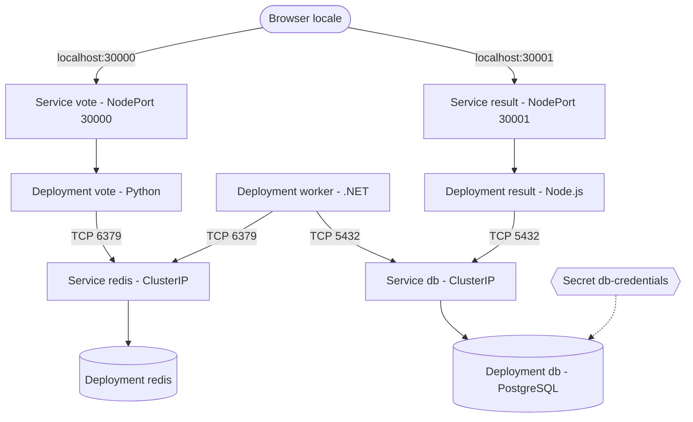

# Architettura

Flusso: l'utente vota su `vote`, il voto va in una coda Redis, il `worker` lo legge e lo scrive in PostgreSQL, `result` legge dal database e mostra i risultati.

| Componente | Risorsa | Service | Accesso |
|---|---|---|---|
| vote | Deployment (1 replica) | NodePort 80 -> 30000 | `http://localhost:30000` |
| result | Deployment (1 replica) | NodePort 80 -> 30001 | `http://localhost:30001` |
| worker | Deployment (1 replica) | nessuno | solo interno |
| redis | Deployment, `emptyDir` | ClusterIP 6379 | solo interno |
| db | Deployment, `emptyDir`, Secret | ClusterIP 5432 | solo interno |

Tutto gira nel namespace `voting-app`. Le porte 30000 e 30001 dell'host sono mappate sul nodo kind in `kind-config.yaml`.